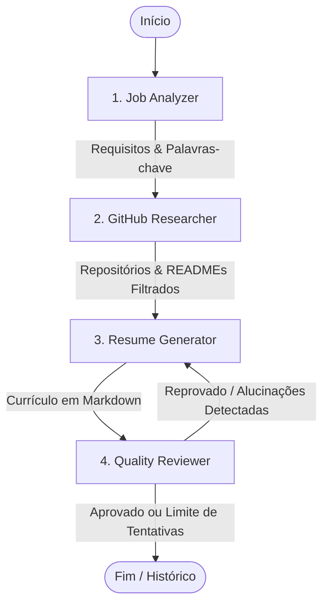

# 🎯 GitMatch: Otimizador Inteligente de Currículos com Base em Portfólio GitHub

[](https://www.python.org/)
[](https://github.com/langchain-ai/langgraph)
[](https://streamlit.io/)
[](https://ai.google.dev/)

> Projeto desenvolvido para a disciplina de **Sistemas Multi-Agentes (SMA)**.

O **GitMatch** é um sistema multi-agente inteligente que adapta e otimiza currículos com base nas exigências de vagas de tecnologia e no histórico real de projetos públicos do candidato no **GitHub**. Ele elimina o trabalho manual e o risco de incompatibilidade com sistemas ATS (*Applicant Tracking Systems*), destacando repositórios reais e garantindo fidelidade factual através de um ciclo de revisão crítica contra alucinações.

---

## 💡 O Problema e a Solução

* **O Problema:** Candidatos a vagas de tecnologia perdem muito tempo adaptando manualmente seus currículos para cada oportunidade e, com frequência, deixam de evidenciar projetos práticos que comprovam os requisitos exigidos pelos filtros de triagem automatizada (ATS).
* **A Abordagem Tradicional (Baseline):** Enviar um prompt único para um LLM com o texto da vaga e o currículo colados. Isso gera alucinações frequentes (ferramentas inventadas) e não aproveita o ecossistema real de código do candidato.
* **A Solução Multi-Agente (GitMatch):** Uma linha de montagem cognitiva com controle de qualidade cíclico via LangGraph. O sistema extrai requisitos técnicos, consulta a API do GitHub para buscar repositórios e READMEs pertinentes, reescreve o currículo destacando evidências comprováveis e submete o resultado a um agente revisor antes da aprovação final.

---

## 🧠 Arquitetura Multi-Agente (LangGraph)

O fluxo do sistema utiliza uma arquitetura orientada a grafos de estado (**LangGraph**) com ciclo condicional de revisão e limite de tentativas:



### 🤖 Agentes e Responsabilidades

| Agente | Função | Entrada | Saída |
| :--- | :--- | :--- | :--- |
| **1. Job Analyzer** | Analisa a descrição da vaga e extrai competências-chave. | Descrição da vaga (texto) | Lista de tecnologias, frameworks e soft skills |
| **2. GitHub Researcher** | Consulta a API do GitHub, filtra repositórios aderentes e baixa seus `README.md`. | Usuário do GitHub + Requisitos técnicos | Metadados de repositórios relevantes e conteúdos de READMEs |
| **3. Resume Generator** | Reestrutura o currículo base, alinha termos ao ATS e insere a seção *"Projetos em Destaque"* com base nos dados do GitHub. | Currículo base + Vaga + READMEs + Feedback anterior | Versão preliminar do currículo otimizado |
| **4. Quality Reviewer** | Compara o currículo gerado com o currículo original e o GitHub para barrar alucinações e checar completude. | Currículo gerado vs. Dados brutos | Veredito (`Aprovado` / `Reprovado`) e orientações de correção |

---

## ✨ Funcionalidades Principais

- 🔍 **Extração Automatizada de Vagas:** Identificação precisa de linguagens, ferramentas e conceitos exigidos.
- 🐙 **Integração Real com o GitHub:** Varredura de repositórios públicos e leitura inteligente de arquivos `README.md`.
- 🛡️ **Defesa Ativa Anti-Alucinação:** O revisor garante que nenhuma tecnologia ou projeto inexistente seja atribuído ao candidato.
- 📄 **Saída em Markdown Formatado:** Currículo pronto para visualização, cópia ou exportação para PDF via navegador.
- 📚 **Histórico Local de Versões:** Armazenamento automático e recuperação de currículos gerados anteriormente via interface.

---

## 🛠️ Tecnologias Utilizadas

- **Linguagem:** [Python 3.10+](https://www.python.org/)
- **Orquestração de Agentes:** [LangGraph](https://github.com/langchain-ai/langgraph) / [LangChain](https://www.langchain.com/)
- **Modelos de Linguagem (LLM):** [Google Gemini](https://ai.google.dev/) (`google-generativeai`)
- **Interface Gráfica:** [Streamlit](https://streamlit.io/)
- **Comunicação com APIs:** [Requests](https://requests.readthedocs.io/) (API REST do GitHub)
- **Gerenciamento de Ambiente:** [python-dotenv](https://pypi.org/project/python-dotenv/)
- **Testes Automatizados:** [pytest](https://docs.pytest.org/)

---

## 📁 Estrutura do Projeto

```text
.
├── app.py                      # Interface Web Streamlit e orquestração da UI
├── requirements.txt            # Dependências do projeto
├── .env.example                # Modelo de variáveis de ambiente
├── history/                    # Diretório onde os currículos gerados são persistidos
├── src/
│   ├── agents/
│   │   ├── graph.py            # Definição e compilação do grafo LangGraph
│   │   ├── nodes.py            # Lógica e prompts dos 4 agentes (nós do grafo)
│   │   └── state.py            # Definição do estado global compartilhado (GraphState)
│   └── core/
│       ├── config.py           # Carregamento de credenciais e variáveis (.env)
│       └── history_manager.py  # Gestão de salvamento e leitura do histórico local
├── tests/                      # Testes automatizados (pytest)
│   ├── test_env.py
│   ├── test_history.py
│   ├── test_nodes.py
│   └── test_state.py
├── arquitetura_gitmatch.md     # Documentação de decisões arquiteturais
└── proposta_do_projeto.md      # Proposta acadêmica e critérios de sucesso
```

---

## 🚀 Como Executar o Projeto

### 1. Pré-requisitos
- **Python 3.10** ou superior instalado.
- Chave de API do **Google Gemini** ([Google AI Studio](https://aistudio.google.com/)).
- *(Opcional, mas recomendado)* **GitHub Personal Access Token** para evitar limites severos de requisições na API pública do GitHub.

### 2. Clonar o Repositório e Criar Ambiente Virtual

```bash
# Clone o repositório
git clone <URL_DO_REPOSITORIO>
cd <PASTA_DO_PROJETO>

# Crie o ambiente virtual
python -m venv venv

# Ative o ambiente virtual
# No Windows (PowerShell):
.\venv\Scripts\Activate.ps1
# No Linux/macOS:
source venv/bin/activate
```

### 3. Instalar as Dependências

```bash
pip install -r requirements.txt
```

### 4. Configurar as Variáveis de Ambiente

Crie um arquivo `.env` na raiz do projeto a partir do modelo `.env.example`:

```bash
# No Windows PowerShell:
Copy-Item .env.example .env

# No Linux/macOS:
cp .env.example .env
```

Edite o arquivo `.env` com suas credenciais:

```env
GEMINI_API_KEY=sua_chave_do_google_gemini_aqui
GITHUB_TOKEN=seu_github_personal_access_token_aqui
```

> **Nota:** A variável `GITHUB_TOKEN` é opcional, porém recomendada para contornar o rate limit de 60 requisições/hora para requisições anônimas.

### 5. Iniciar a Aplicação

Inicie a interface web com o Streamlit:

```bash
streamlit run app.py
```

Acesse `http://localhost:8501` no seu navegador.

---

## 🧪 Executando os Testes

Para rodar os testes unitários e de integração com `pytest`:

```bash
pytest
```

---

## 👥 Integrantes do Grupo

- Thiago e integrantes do grupo *(adicione os nomes dos participantes aqui)*

---

## 📄 Licença

Este projeto é desenvolvido para fins acadêmicos como parte do curso de **Sistemas Multi-Agentes**.
