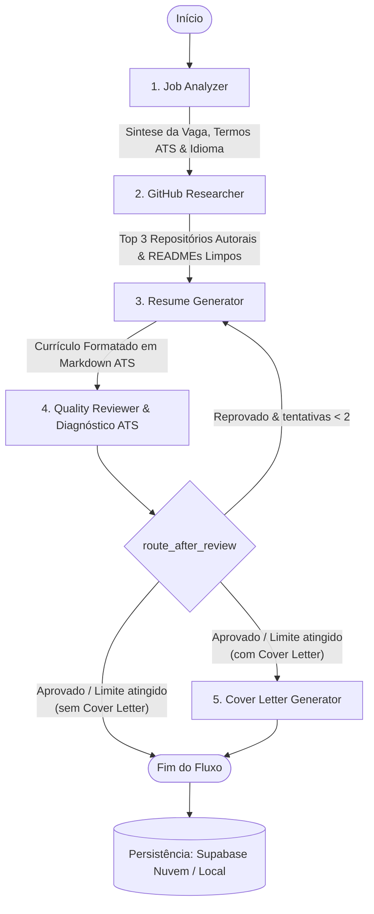

# 🎯 GitMatch - CV Nitro: Otimizador Inteligente de Currículos com Base em Portfólio GitHub, ATS e Persistência em Nuvem

[](https://cvnitro-xzvgi43qkmsbovbt87h9bz.streamlit.app/)
[](https://www.python.org/)
[](https://github.com/langchain-ai/langgraph)
[](https://streamlit.io/)
[](https://ai.google.dev/)
[](https://groq.com/)
[](https://supabase.com/)
[](https://docs.pytest.org/)
[](LICENSE)

> 🚀 **Aplicação em Produção (Deploy Ativo):** [https://cvnitro-xzvgi43qkmsbovbt87h9bz.streamlit.app/](https://cvnitro-xzvgi43qkmsbovbt87h9bz.streamlit.app/)
>
> Projeto prático avançado desenvolvido para a disciplina de **Sistemas Multi-Agentes (SMA)**.

O **GitMatch (CV Nitro)** é um ecossistema multi-agente inteligente projetado para transformar currículos técnicos comuns em candidaturas executivas de alto impacto, totalmente alinhadas às exigências de vagas reais de tecnologia e comprovadas por projetos reais públicos do candidato no **GitHub**.

Diferente de geradores convencionais baseados em prompts únicos (suscetíveis a alucinações e textos genéricos), o CV Nitro adota uma **linha de produção cognitiva orquestrada em grafo de estados via LangGraph**, com **defesa ativa anti-alucinação em dois níveis**, **auditoria determinística ATS (Applicant Tracking Systems)**, **resiliência multi-provedor (Gemini + Groq)**, **autenticação com sessão persistente**, e uma **camada de persistência híbrida pronta para nuvem (Supabase PostgreSQL + Fallback Local)**.

---

## 📑 Tabela de Conteúdos

- [💡 O Problema e a Solução](#-o-problema-e-a-solução)
- [🤖 Seção Especial: Arquitetura e Engenharia dos Agentes](#-seção-especial-arquitetura-e-engenharia-dos-agentes)
  - [Por que Sistemas Multi-Agentes (SMA) em vez de Prompt Único?](#por-que-sistemas-multi-agentes-sma-em-vez-de-prompt-único)
  - [Topologia do Grafo Cognitivo (LangGraph)](#topologia-do-grafo-cognitivo-langgraph)
  - [Papéis, Importância e Escolhas Técnicas de Cada Agente](#papéis-importância-e-escolhas-técnicas-de-cada-agente)
  - [Arestas Condicionais e Circuit Breaker](#arestas-condicionais-e-circuit-breaker)
  - [Resiliência Multi-Provedor (Gemini + Groq)](#resiliência-multi-provedor-gemini--groq)
- [🗺️ Mapeamento Completo de Funcionalidades do Sistema](#️-mapeamento-completo-de-funcionalidades-do-sistema)
  - [1. Autenticação Segura & Sessão Persistente](#1-autenticação-segura--sessão-persistente)
  - [2. Gestão de Perfil do Candidato](#2-gestão-de-perfil-do-candidato)
  - [3. Assistente de Otimização (Wizard em 3 Etapas)](#3-assistente-de-otimização-wizard-em-3-etapas)
  - [4. Painel de Diagnóstico ATS (O "Raio-X")](#4-painel-de-diagnóstico-ats-o-raio-x)
  - [5. Central de Candidaturas & Visualizador Multi-Abas](#5-central-de-candidaturas--visualizador-multi-abas)
  - [6. Dashboard Executivo & Métricas de Mercado](#6-dashboard-executivo--métricas-de-mercado)
  - [7. Configurações & Diagnóstico do Sistema](#7-configurações--diagnóstico-do-sistema)
- [☁️ Persistência de Dados & Deploy em Nuvem](#️-persistência-de-dados--deploy-em-nuvem)
- [⚡ Estratégias de Otimização de Tokens & Latência](#-estratégias-de-otimização-de-tokens--latência)
- [🛠️ Tecnologias Utilizadas](#️-tecnologias-utilizadas)
- [📁 Estrutura do Repositório](#-estrutura-do-repositório)
- [🚀 Como Executar Localmente](#-como-executar-localmente)
- [🧪 Executando os Testes Automatizados (82 Testes)](#-executando-os-testes-automatizados-82-testes)
- [📄 Licença](#-licença)

---

## 💡 O Problema e a Solução

### 1. O Desafio dos Sistemas ATS no Mercado Atual
A triagem inicial de vagas de tecnologia é massivamente automatizada por plataformas ATS (*Applicant Tracking Systems*, como Gupy, Lever, Workday e Greenhouse). Candidatos altamente qualificados são descartados sumariamente por:
- **Ausência de Correspondência Textual Exata:** Falta de termos e sinônimos técnicos canônicos da vaga.
- **Formatação Inadequada para Parsing:** Layouts complexos com múltiplas colunas, imagens ou ícones que quebram o extrator de texto dos robôs.
- **Falta de Validação Factual:** Dificuldade em comprovar a profundidade técnica através de projetos e repositórios reais.
- **Inconsistência de Idioma:** Vagas em inglês ou espanhol respondidas com currículos parcialmente traduzidos.

### 2. A Falha dos Geradores Convencionais (*Single Prompt*)
Submeter o currículo e a vaga a um LLM convencional com instruções genéricas gera graves efeitos colaterais:
- **Alucinação Factual:** Criação de ferramentas, anos de experiência ou cargos que o candidato nunca exerceu.
- **Links Falsos:** Geração de URLs inexistentes de repositórios no GitHub.
- **Desperdício de Tokens:** O modelo processa milhares de tokens de textos institucionais da vaga (políticas de RH, benefícios, interface do site) que não agregam valor ao currículo.

### 3. A Resposta do GitMatch (CV Nitro)
O GitMatch implementa uma **linha de produção modular** inspirada nos princípios da Engenharia de Software e Sistemas Multi-Agentes: cada agente possui uma especialidade estrita, isolamento de contexto, validações determinísticas de custo zero em tokens e verificação cruzada de qualidade antes da entrega.

---

## 🤖 Seção Especial: Arquitetura e Engenharia dos Agentes

### Por que Sistemas Multi-Agentes (SMA) em vez de Prompt Único?

1. **Separação de Preocupações (*Separation of Concerns*):** Analisar requisitos de vagas, filtrar repositórios na API, redigir o currículo e auditar conformidade exigem raciocínios e temperaturas distintas.
2. **Eliminação de Alucinações via Auditoria Cruzada:** Um agente gerador não pode auditar a si mesmo com rigor. O `quality_reviewer` atua como um crítico independente.
3. **Eficiência de Tokens e Custo:** Em vez de trafegar descrições de 3.000 palavras em todas as chamadas, o primeiro agente sintetiza a oportunidade, reduzindo os custos de inferência em até 60%.
4. **Resiliência e Tolerância a Falhas:** Falhas em agentes secundários (como a API do GitHub ou a Cover Letter) são tratadas como não-fatais, garantindo a entrega do currículo otimizado.

---

### Topologia do Grafo Cognitivo (LangGraph)

O fluxo é orquestrado em torno de um grafo direcionado cíclico com estado tipado compartilhado ([GraphState](file:///c:/Users/Thiago/Desktop/Faculdade/sistemas-multi-agentes/cv_nitro/src/agents/state.py)):



---

### Papéis, Importância e Escolhas Técnicas de Cada Agente

#### 🎯 1. Job Analyzer (`job_analyzer`)
* **Papel:** Analista especialista em triagem e extração de requisitos de vagas de tecnologia.
* **Importância:** Funciona como o alicerce do fluxo. Se o idioma ou os termos forem mal identificados, todo o restante da cadeia gerará resultados distorcidos.
* **Principais Escolhas Técnicas & Motivações:**
  - **Saída Estruturada via Pydantic ([JobAnalysis](file:///c:/Users/Thiago/Desktop/Faculdade/sistemas-multi-agentes/cv_nitro/src/agents/nodes.py#L66-L74)):** Garante tipagem estrita de `keywords`, `technologies`, `language` e `summary`.
  - **`job_summary` Enxuto (~150 palavras):** A vaga bruta contém textos irrelevantes (benefícios, cultura da empresa, declarações de diversidade, cabeçalhos de sites). O analisador resume os requisitos e substitui a vaga original por `_job_context()`, **economizando centenas de tokens em cada nó seguinte**.
  - **Detecção Robusta de Idioma:** Avalia o corpo dos requisitos ignorando textos fixos da interface de portais de emprego (ex.: *"Candidatar-se à vaga"*).

---

#### 🐙 2. GitHub Researcher (`github_researcher`)
* **Papel:** Investigador de portfólio e curador de evidências técnicas reais do candidato.
* **Importância:** Conecta o currículo a projetos reais, impedindo que o candidato liste apenas palavras-chave soltas sem embasamento prático.
* **Principais Escolhas Técnicas & Motivações:**
  - **Execução 100% Determinística (0 Tokens de LLM):** Toda a busca, ranqueamento e higienização roda em código Python puro sem gastar nenhum token de IA.
  - **Filtragem Anti-Fork:** Repositórios que são forks de outros criadores são penalizados ou descartados, priorizando trabalhos autorais.
  - **Algoritmo de Relevância Ponderada ([_score_repository](file:///c:/Users/Thiago/Desktop/Faculdade/sistemas-multi-agentes/cv_nitro/src/agents/nodes.py#L112-L150)):**
    - `+4.0` se a linguagem principal coincidir com a stack da vaga;
    - `+2.5` por tópico/tag correspondente;
    - `+1.5` por ocorrência de tecnologias na descrição (usando regex com limites de palavra `\b` para evitar falsos positivos como `"c"` em `"react"` ou `"go"` em `"google"`);
    - Bônus incremental por estrelas (*stargazers*).
  - **Higienização de README ([_clean_readme](file:///c:/Users/Thiago/Desktop/Faculdade/sistemas-multi-agentes/cv_nitro/src/agents/nodes.py#L152-L189)):** Remove badges markdown, tags HTML, seções triviais de licença e comandos de instalação, preservando apenas o extrato técnico da arquitetura (limitado a 1.200 caracteres).
  - **Validação de Segurança:** Regex de segurança sobre o nome de usuário do GitHub para proteção contra injeções.

---

#### 📄 3. Resume Generator (`resume_generator`)
* **Papel:** Redator executivo especializado em formatação de alta fidelidade e triagem ATS.
* **Importância:** Consolida o currículo base, a síntese da vaga e os projetos do GitHub em um documento elegante, legível por robôs e humanos.
* **Principais Escolhas Técnicas & Motivações:**
  - **Internacionalização Estrita com Dicionário Canônico ([LABELS](file:///c:/Users/Thiago/Desktop/Faculdade/sistemas-multi-agentes/cv_nitro/src/agents/nodes.py#L15-L40)):** Mapeia títulos de seção, categorias da tabela, níveis de idioma e cabeçalhos em `pt`, `en` e `es`. Se a vaga for em inglês, todo o currículo base é traduzido integralmente para inglês, mantendo no original apenas nomes próprios e tecnologias.
  - **Estrutura ATS Padronizada:**
    - Seção de habilidades técnicas em **Tabela Markdown de 2 colunas** com separador `| :--- | :--- |` (o formato mais legível por parsers ATS).
    - Bullets de experiência no padrão `- **Tópico de Impacto:** verbo forte + escopo + resultado mensurável`.
    - Seção de projetos enriquecida com as URLs reais e arquiteturas do GitHub.
  - **Guarda Anti-Alucinação:** Proibição estrita de inventar cargos, empresas ou repositórios não fornecidos.
  - **Loop de Refinamento:** Recebe diretamente o parecer do revisor (`reviewer_feedback`) para correções pontuais quando vindo de uma reprovação.

---

#### 🔍 4. Quality Reviewer & Diagnóstico ATS (`quality_reviewer`)
* **Papel:** Auditor rigoroso de conformidade estrutural, fidelidade factual e compatibilidade ATS.
* **Importância:** Garante que o documento final não contenha erros graves antes de ser entregue ao usuário, atribuindo um score auditável.
* **Principais Escolhas Técnicas & Motivações:**
  - **Arquitetura Híbrida em Dois Níveis (Two-Tier Audit):**
    1. **Tier 1 (Determinístico - Custo Zero de IA):**
       - *Placeholders Residuais:* Detecta tags não preenchidas como `<Nome>`, `<Empresa>` (excetuando e-mails válidos).
       - *Integridade de URLs do GitHub:* Cruza todas as URLs do GitHub citadas no currículo gerado contra os repositórios reais obtidos pela API. **Se a IA inventar uma URL de repositório, o Tier 1 reprova imediatamente**.
       - *Validação de Tabela:* Checa a presença da tabela de habilidades.
       - *Score ATS Matemático:* Calcula a cobertura real de tecnologias e keywords com pesos estruturais (50 a 98).
    2. **Tier 2 (Auditoria Semântica com LLM):**
       - Só é acionado se passar no Tier 1 e se o usuário tiver optado pelo modo estrito (`strict_review=True`).
       - Avalia pureza do idioma e alucinações contextuais com saída Pydantic ([ReviewResult](file:///c:/Users/Thiago/Desktop/Faculdade/sistemas-multi-agentes/cv_nitro/src/agents/nodes.py#L475-L480)).
       - Pondera a nota final: `60% determinístico + 40% LLM`.
  - **Modo Econômico de Execução:** Quando `strict_review=False`, o nó encerra a revisão usando unicamente o Tier 1, poupando uma chamada de LLM pesada e entregando resposta instantânea.
  - **Tolerância a Falhas da API:** Se a API de IA falhar durante a revisão, o nó não bloqueia a execução nem gera loops infinitos: salva o diagnóstico determinístico, registra o erro na lista `errors` do estado e prossegue para salvar o currículo.

---

#### ✉️ 5. Cover Letter Generator (`cover_letter_generator`)
* **Papel:** Especialista sênior em redação de cartas de apresentação persuasivas para tecnologia.
* **Importância:** Gera uma narrativa complementar de alto valor que conecta os projetos do candidato às dores reais da empresa contratante.
* **Principais Escolhas Técnicas & Motivações:**
  - **Estrutura Clássica em 4 Atos:**
    1. *Abertura Formal:* Entusiasmo e identificação imediata da posição.
    2. *Conexão Técnica:* Conexão entre as dores da vaga e os projetos reais do GitHub do candidato.
    3. *Fit Cultural & Proposta de Valor:* Alinhamento com a missão da empresa.
    4. *Fechamento Cordial:* Solicitação formal de entrevista técnica.
  - **Execução Opcional e Desacoplada:** O usuário pode desativar a carta no assistente (`generate_cover_letter=False`), economizando tempo e 40% dos tokens totais da pipeline.
  - **Isolamento de Falhas:** Caso a geração da carta falhe, o currículo principal permanece salvo e utilizável.

---

### Arestas Condicionais e Circuit Breaker

A função de roteamento [route_after_review](file:///c:/Users/Thiago/Desktop/Faculdade/sistemas-multi-agentes/cv_nitro/src/agents/graph.py#L12-L22) implementa uma máquina de decisão inteligente:

1. **Reprovação com Tentativas Restantes (`tentativas < 2`):**
   - O fluxo retorna para o `resume_generator`, injetando o feedback explicativo do revisor para correção direcionada.
2. **Aprovação OU Limite de Tentativas Esgotado (`MAX_REVIEW_ATTEMPTS = 2`):**
   - Se o usuário desmarcou a carta (`generate_cover_letter=False`), o fluxo segue diretamente para `END`.
   - Se a carta estiver ativa, segue para `cover_letter_generator` e em seguida finaliza em `END`.
3. **Mecanismo *Circuit Breaker*:** Garante que o grafo nunca entre em loops infinitos de regeneração, limitando estritamente a 2 rodadas.

---

### Resiliência Multi-Provedor (Gemini + Groq)

Para mitigar os frequentes erros de limite de requisições por minuto (`HTTP 429`) e indisponibilidade temporária de servidores (`HTTP 503`):

- **Encadeamento com Fallback Transparente ([_llm](file:///c:/Users/Thiago/Desktop/Faculdade/sistemas-multi-agentes/cv_nitro/src/agents/nodes.py#L42-L60)):**
  - **Nível 1 (Principal):** Modelo Google Gemini configurado (`GEMINI_MODEL`, ex.: `gemini-2.0-flash-lite`).
  - **Nível 2 (Fallback Google):** Modelo secundário (`GEMINI_FALLBACK_MODEL`, ex.: `gemini-3.6-flash`).
  - **Nível 3 (Fallback Groq):** Caso o `GROQ_API_KEY` esteja presente no `.env`, a requisição é automaticamente repassada para o provedor Groq (`ChatGroq`, com modelos de ultra-baixa latência como `openai/gpt-oss-120b`).
- **Níveis de Raciocínio (*Thinking Levels*):** Chamadas curtas usam `thinking_level="low"` para reduzir latência; a reescrita do currículo usa `thinking_level=None` para máxima qualidade textual.

---

## 🗺️ Mapeamento Completo de Funcionalidades do Sistema

A aplicação cobre integralmente o ciclo de vida da otimização de currículos, dividida nos seguintes módulos:

### 1. Autenticação Segura & Sessão Persistente
- **Login e Cadastro com Supabase Auth:** Suporte a criação de contas com e-mail e senha com validações completas.
- **Modo Convidado (*Guest Local*):** Usuários não cadastrados podem testar a aplicação livremente com armazenamento local.
- **Sessão Persistente contra F5:** Tokens assinados integrados ao `localStorage` evitam que o recarregamento de página (F5) derrube a sessão do usuário.

### 2. Gestão de Perfil do Candidato
- **Armazenamento Permanente de Dados:** Salve seu currículo base, nome completo e usuário do GitHub uma única vez no painel **Perfil**.
- **Auto-preenchimento no Assistente:** Ao iniciar uma nova otimização, o assistente carrega automaticamente os dados do seu perfil, agilizando o fluxo.

### 3. Assistente de Otimização (Wizard em 3 Etapas)
- **Etapa 1 (Currículo Base):** Upload múltiplo (`.pdf`, `.docx`, `.md`, `.txt`) com parser e editor de texto acoplado para ajustes finos.
- **Etapa 2 (Vaga Alvo):** Título do cargo, link da oportunidade, usuário do GitHub e campo de texto para a descrição.
- **Etapa 3 (Preferências de IA & Tokens):**
  - Toggle *Gerar Carta de Apresentação* (liga/desliga).
  - Toggle *Auditoria Rígida de Qualidade* (liga auditoria semântica ou ativa modo econômico ultra-rápido).
- **Monitor Visual:** Barra de progresso com status de cada agente durante a execução do grafo.

### 4. Painel de Diagnóstico ATS (O "Raio-X")
- **Score ATS Auditável:** Nota de 50 a 98 calculada com base na densidade de tecnologias e palavras-chave.
- **Mapeamento de Termos:** Visualização das tecnologias e competências que foram integradas ao texto.
- **Parecer do Revisor:** Resumo executivo das alterações estruturais aplicadas.

### 5. Central de Candidaturas & Visualizador Multi-Abas
- **Busca e Filtros Instantâneos:** Localize candidaturas por cargo, empresa ou tecnologias.
- **Visualizador em 4 Abas:**
  - 🎯 **Diagnóstico ATS:** Relatório detalhado de qualidade.
  - 📑 **Folha Formatada (A4):** Diagramação profissional em CSS pronta para impressão ou exportação para PDF (`Ctrl + P`).
  - 📄 **Markdown Puro:** Código pronto para copiar ou usar em plataformas digitais.
  - ✉️ **Carta de Apresentação:** Texto persuasivo estruturado para envio ao recrutador.
- **Re-otimizador Inteligente:** Ajuste a descrição da vaga ou o currículo e dispare uma nova rodada sem recomeçar do zero.

### 6. Dashboard Executivo & Métricas de Mercado
- **Cards Analíticos:** Total de candidaturas, Score ATS médio, proporção de idiomas (PT/EN/ES) e volume de stacks identificadas.
- **Gráficos Interativos:** Ranking das tecnologias mais exigidas pelas vagas cadastradas.
- **Barra Lateral com Recentes:** Acesso rápido com um clique às últimas candidaturas salvas.

### 7. Configurações & Diagnóstico do Sistema
- Verificação do status de conexão com o banco de dados (Supabase Nuvem vs. Local).
- Validação das chaves de API (`GEMINI_API_KEY`, `GROQ_API_KEY`, `GITHUB_TOKEN`).
- Identificação dos modelos ativos e orientações para prevenção de limites de cota.

---

## ☁️ Persistência de Dados & Deploy em Nuvem

### Estratégia Híbrida: Supabase vs. Armazenamento Local

Ambientes como o **Streamlit Community Cloud** utilizam contêineres efêmeros (o disco local é resetado em novos deploys). Para garantir a integridade dos dados:

- **Persistência em Nuvem (Supabase):** Quando configurado com `SUPABASE_URL` e `SUPABASE_KEY`, todas as candidaturas, perfis e diagnósticos são gravados em tabelas PostgreSQL com políticas de segurança RLS (*Row Level Security*).
- **Fallback Local Automático:** Sem as credenciais de nuvem, o sistema grava automaticamente arquivos Markdown estruturados no diretório `history/`, mantendo o app 100% funcional offline.

---

## ⚡ Estratégias de Otimização de Tokens & Latência

| Estratégia | Onde Atua | Benefício Real |
| :--- | :--- | :--- |
| **Resumo da Vaga (`_job_context`)** | `job_analyzer` | Reduz o texto da vaga em até 85%, cortando ruídos de RH de todas as etapas seguintes. |
| **Curadoria Determinística de Repositórios** | `github_researcher` | **0 tokens consumidos** para busca, filtro anti-fork, ranqueamento e higienização de READMEs. |
| **Auditoria Determinística Tier 1** | `quality_reviewer` | **0 tokens consumidos** para checar links falsos, placeholders e calcular a cobertura ATS. |
| **Modo Econômico de Revisão** | Toggle no Wizard | Pula a auditoria semântica do Tier 2, economizando ~35% dos tokens com resposta imediata. |
| **Toggle de Cover Letter** | Toggle no Wizard | Evita uma chamada de IA pesada caso a vaga não exija carta de apresentação (-40% de tokens). |
| **Reserva Automática Groq** | `_llm` fallback | Evita bloqueios por estouro de cota (429) do tier gratuito do Gemini. |

---

## 🛠️ Tecnologias Utilizadas

- **Linguagem Principal:** [Python 3.10+](https://www.python.org/)
- **Orquestração de Grafos:** [LangGraph](https://github.com/langchain-ai/langgraph) & [LangChain Core](https://www.langchain.com/)
- **Modelos de Linguagem:** [Google Gemini 3.x / Flash](https://ai.google.dev/) e [Groq](https://groq.com/)
- **Interface Web:** [Streamlit](https://streamlit.io/)
- **Banco de Dados em Nuvem:** [Supabase](https://supabase.com/) (PostgreSQL & Supabase Auth)
- **Extração de Documentos:** [PyPDF](https://pypdf.readthedocs.io/) e [python-docx](https://python-docx.readthedocs.io/)
- **Integração Externa:** API REST v3 do GitHub via [Requests](https://requests.readthedocs.io/)
- **Suíte de Testes:** [pytest](https://docs.pytest.org/) com 82 testes automatizados
- **Metodologia de Especificação:** [OpenSpec](https://github.com/openspec)

---

## 📁 Estrutura do Repositório

```text
cv_nitro/
├── app.py                      # Ponto de entrada da aplicação Streamlit e roteamento de páginas
├── requirements.txt            # Dependências do projeto
├── .env.example                # Modelo de configuração de variáveis de ambiente
├── supabase_schema.sql         # Script DDL com tabelas e políticas RLS para Supabase
├── pytest.ini                  # Configurações da suíte de testes pytest
├── history/                    # Fallback local para armazenamento de candidaturas (.md)
├── profiles/                   # Armazenamento local de perfis de usuário
│
├── src/
│   ├── agents/
│   │   ├── graph.py            # Definição do StateGraph, nós, arestas e roteamento cíclico
│   │   ├── nodes.py            # Implementação dos 5 nós agentes, prompts e cliente resiliente
│   │   └── state.py            # Definição do estado global compartilhado (GraphState)
│   │
│   ├── core/
│   │   ├── auth_manager.py     # Gerenciamento de autenticação e sessões (Supabase Auth / Guest)
│   │   ├── config.py           # Carregamento e validação de configurações e variáveis de ambiente
│   │   ├── db_migrator.py      # Migrações e sincronização de esquemas de banco de dados
│   │   ├── document_parser.py  # Extrator de arquivos PDF, DOCX, TXT e Markdown
│   │   ├── history_manager.py  # Persistência híbrida (Supabase Cloud + Fallback Local)
│   │   ├── profile_manager.py  # Gerenciamento de perfis de candidatos persistentes
│   │   └── resume_formatter.py # Conversor de Markdown para visualização diagramada em folha A4
│   │
│   └── ui/
│       ├── navbar.py           # Barra de navegação superior com alternador de temas e controle de sessão
│       ├── components.py       # Componentes visuais reutilizáveis, cabeçalhos e sincronização
│       ├── wizard_view.py      # Assistente de otimização em 3 etapas
│       ├── dashboard_view.py   # Painel com métricas consolidadas e gráficos
│       ├── applications_view.py# Central de candidaturas com busca e visualizador em 4 abas
│       ├── diagnostic_view.py  # Componente visual para renderização do Raio-X ATS
│       ├── profile_view.py     # Tela de gerenciamento do perfil do usuário
│       ├── settings_view.py    # Monitor de integridade do sistema e chaves de API
│       ├── auth_views.py       # Telas de Login, Cadastro e Recuperação de Acesso
│       └── landing_view.py     # Página institucional inicial para visitantes
│
├── tests/                      # Bateria com 82 testes automatizados
│   ├── test_agents.py          # Testes de roteamento e branches do grafo
│   ├── test_agent_quality_improvements.py # Testes de resiliência e validações determinísticas
│   ├── test_auth_manager.py    # Testes unitários do fluxo de autenticação e sessões
│   ├── test_auth_views.py      # Testes de renderização de telas de autenticação
│   ├── test_db_migrator.py     # Testes de integridade de esquema
│   ├── test_document_parser.py # Testes de parsing de PDF, DOCX e TXT
│   ├── test_end_to_end_flow.py # Teste E2E do pipeline completo
│   ├── test_history.py         # Testes de persistência no Supabase e fallback local
│   ├── test_navbar.py          # Testes de alternância de rotas e menus
│   ├── test_nodes.py           # Testes específicos de cada nó de agente
│   ├── test_profile_manager.py # Testes de gerenciamento de perfis
│   ├── test_resume_formatter.py# Testes da renderização de layout A4
│   ├── test_state.py           # Validação da estrutura tipada do GraphState
│   └── test_ui.py              # Testes unitários de componentes visuais
│
└── openspec/                   # Especificações formais e controle de mudanças arquiteturais
```

---

## 🚀 Como Executar Localmente

### 1. Clonar o Repositório e Configurar o Ambiente Virtual

```powershell
# No Windows (PowerShell):
git clone https://github.com/thiagoeu/cv_nitro.git
cd cv_nitro

python -m venv venv
.\venv\Scripts\Activate.ps1
```

```bash
# No Linux / macOS:
git clone https://github.com/thiagoeu/cv_nitro.git
cd cv_nitro

python3 -m venv venv
source venv/bin/activate
```

### 2. Instalar as Dependências

```bash
pip install --upgrade pip
pip install -r requirements.txt
```

### 3. Configurar as Variáveis de Ambiente (`.env`)

Copie o modelo de configuração:
```bash
cp .env.example .env
```

Preencha as chaves no arquivo `.env`:
```env
# Google AI Studio (Obrigatório)
GEMINI_API_KEY=sua_chave_gemini_aqui
GEMINI_MODEL=gemini-2.0-flash-lite
GEMINI_FALLBACK_MODEL=gemini-3.6-flash

# Provedor Groq para Fallback Rápido (Opcional, mas recomendado)
GROQ_API_KEY=sua_chave_groq_aqui
GROQ_MODEL=openai/gpt-oss-120b

# Token do GitHub (Opcional, evita limite de 60 req/hora)
GITHUB_TOKEN=seu_github_token_aqui

# Supabase (Opcional: deixe em branco para persistência local em history/)
SUPABASE_URL=https://seu-projeto.supabase.co
SUPABASE_KEY=sua_chave_publica_anon
```

### 4. Iniciar a Aplicação

```bash
streamlit run app.py
```

O painel será aberto automaticamente no seu navegador em: `http://localhost:8501`

---

## 🧪 Executando os Testes Automatizados (82 Testes)

A aplicação conta com uma bateria de **82 testes automatizados** cobrindo agentes, parsers, persistência, componentes visuais e autenticação:

```bash
pytest
```

Para visualizar a execução detalhada teste a teste:
```bash
pytest -v
```

---

## 📄 Licença

Este projeto é distribuído sob a licença **MIT** e desenvolvido para fins acadêmicos e práticos na área de Inteligência Artificial e Sistemas Multi-Agentes.
