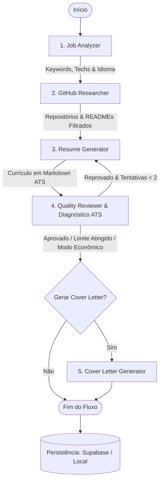

# 🎯 GitMatch - CV Nitro: Otimizador Inteligente de Currículos com Base em Portfólio GitHub, ATS e Persistência em Nuvem

[](https://www.python.org/)
[](https://github.com/langchain-ai/langgraph)
[](https://streamlit.io/)
[](https://ai.google.dev/)
[](https://supabase.com/)
[](https://docs.pytest.org/)
[](LICENSE)

> Projeto prático avançado desenvolvido para a disciplina de **Sistemas Multi-Agentes (SMA)**.

O **GitMatch (CV Nitro)** é um ecossistema multi-agente inteligente projetado para transformar currículos técnicos comuns em candidaturas executivas de alto impacto, totalmente alinhadas às exigências de vagas reais de tecnologia e comprovadas por projetos reais públicos do candidato no **GitHub**. 

Diferente de soluções convencionais baseadas em prompts únicos e propensas a alucinações, o GitMatch adota uma **linha de montagem cognitiva orquestrada em grafo cíclico via LangGraph**, com **defesa ativa anti-alucinação**, **auditoria de conformidade ATS (Applicant Tracking Systems)**, **resiliência com fallback automático de modelos de IA**, **opções de controle e economia de tokens**, e uma **camada de persistência híbrida pronta para deploy em nuvem (Supabase + Fallback Local)**.

---

## 📑 Tabela de Conteúdos

- [💡 O Problema e a Solução](#-o-problema-e-a-solução)
- [🧠 Arquitetura Multi-Agente (LangGraph)](#-arquitetura-multi-agente-langgraph)
  - [Papéis e Responsabilidades dos Agentes](#-papéis-e-responsabilidades-dos-agentes)
  - [Resiliência & Fallback Automático de Modelos](#-resiliência--fallback-automático-de-modelos)
- [🎯 Painel de Diagnóstico ATS (O "Raio-X")](#-painel-de-diagnóstico-ats-o-raio-x)
- [🖥️ Interface da Aplicação (Módulos & Menu)](#️-interface-da-aplicação-módulos--menu)
- [☁️ Persistência de Dados & Deploy em Nuvem](#️-persistência-de-dados--deploy-em-nuvem)
  - [Estratégia Híbrida: Supabase vs. Armazenamento Local](#estratégia-híbrida-supabase-vs-armazenamento-local)
  - [Configuração do Banco no Supabase](#configuração-do-banco-no-supabase)
  - [Deploy no Streamlit Community Cloud](#deploy-no-streamlit-community-cloud)
- [⚡ Estratégias de Economia de Tokens & Cotas de IA](#-estratégias-de-economia-de-tokens--cotas-de-ia)
- [🛠️ Tecnologias Utilizadas](#️-tecnologias-utilizadas)
- [📁 Estrutura do Repositório](#-estrutura-do-repositório)
- [🚀 Como Executar o Projeto Localmente](#-como-executar-o-projeto-localmente)
- [🧪 Executando os Testes Automatizados](#-executando-os-testes-automatizados)
- [👥 Integrantes do Projeto](#-integrantes-do-projeto)
- [📄 Licença](#-licença)

---

## 💡 O Problema e a Solução

### 1. O Problema
No mercado de tecnologia atual, a triagem primária de currículos é dominada por plataformas automatizadas (**ATS** - como Gupy, Lever, Workday e Greenhouse). Candidatos altamente qualificados são frequentemente descartados por:
- Falta de correspondência textual exata de palavras-chave exigidas pela vaga.
- Falta de evidências técnicas tangíveis de suas competências práticas.
- Layouts complexos que impedem a leitura adequada pelos robôs de triagem.
- Dificuldade de adaptar manualmente o currículo para dezenas de vagas distintas.

### 2. A Abordagem Tradicional (*Baseline*)
Enviar o currículo e a descrição da vaga em um prompt único para um LLM comum resulta em:
- **Alucinações graves:** A IA frequentemente inventa ferramentas, anos de experiência ou cargos que o candidato nunca exerceu.
- **Isolamento de contexto:** A IA não tem acesso ao trabalho prático desenvolvido pelo candidato.
- **Saída imprevisível:** Textos genéricos, sem formatação padronizada e sem garantias de métricas.

### 3. A Solução Multi-Agente (GitMatch / CV Nitro)
O GitMatch implementa uma linha de produção cognitiva especializada dividida em agentes autônomos com responsabilidades estritas:
1. **Extração factual:** Analisa os requisitos técnicos, soft skills e idioma da vaga alvo.
2. **Investigação de evidências:** Varre o GitHub do candidato, selecionando repositórios e lendo arquivos `README.md` reais.
3. **Reescrita padronizada:** Gera o currículo em Markdown ATS executivo, com tabela técnica de 2 colunas, bullets de impacto (`- **Tópico:** Ação + Escopo + Métrica`) e seção de projetos comprovados.
4. **Auditoria rigorosa:** Um auditor independente valida o resultado contra alucinações, idioma e formato, gerando um **Diagnóstico de Compatibilidade ATS**.
5. **Carta de apresentação sob medida:** Elabora uma Cover Letter persuasiva conectando a bagagem do candidato aos desafios da oportunidade.

---

## 🧠 Arquitetura Multi-Agente (LangGraph)

O fluxo é orquestrado como um grafo direcionado de estados finitos (**LangGraph**), permitindo bifurcações, controle condicional de execução e loops de refinamento com limite de tentativas (*circuit breaker*):



### 🤖 Papéis e Responsabilidades dos Agentes

| Agente / Nó | Módulo / Função | Entrada | Saída / Responsabilidade |
| :--- | :--- | :--- | :--- |
| **1. Job Analyzer** | `job_analyzer` | Descrição bruta da vaga | Extrai palavras-chave essenciais, tecnologias obrigatórias/desejáveis e idioma predominante (`pt`, `en`, `es`) via saída estruturada Pydantic. |
| **2. GitHub Researcher** | `github_researcher` | Usuário do GitHub + Tecnologias da vaga | Consulta a API REST do GitHub, filtra até os 3 repositórios mais relevantes alinhados à vaga e extrai o conteúdo dos seus `README.md`. |
| **3. Resume Generator** | `resume_generator` | Currículo Base + Vaga + READMEs + Feedback anterior | Reescreve o currículo em Markdown de alta fidelidade, traduz integralmente para o idioma da vaga (se necessário), formata habilidades em tabela de 2 colunas e enriquece projetos. |
| **4. Quality Reviewer** | `quality_reviewer` | Currículo gerado vs. Currículo base e READMEs | Audita o documento contra alucinações, conformidade de idioma e regras de layout ATS. Calcula o **Score ATS**, mapeia palavras-chave e emite o parecer explicativo. |
| **5. Cover Letter Generator** | `cover_letter_generator` | Currículo gerado + Descrição da vaga + Projetos | *(Opcional)* Redige uma carta de apresentação elegante, altamente persuasiva e contextualizada com os projetos do candidato. |

---

### 🛡️ Resiliência & Fallback Automático de Modelos

Para garantir alta disponibilidade e evitar travamentos na interface do usuário diante de sobrecargas de servidores de IA:
- **Tratamento de Erros 503 (High Demand):** O cliente LLM central (`src/agents/nodes.py`) utiliza o mecanismo `with_fallbacks()` da LangChain.
- **Alternância Transparente:** Caso o modelo principal (`GEMINI_MODEL`, ex.: `gemini-3.8-flash`) retorne código `503 ServerError`, o sistema automaticamente repassa a requisição para o modelo de contingência (`GEMINI_FALLBACK_MODEL`, ex.: `gemini-3.6-flash`), sem interromper a execução nem perder o estado.
- **Timeouts Controlados:** Chamadas com timeout máximo de 300s e retries limitados evitam bloqueios infinitos de threads.

---

## 🎯 Painel de Diagnóstico ATS (O "Raio-X")

Em vez de entregar o currículo como uma "caixa preta", o CV Nitro disponibiliza um painel analítico pós-otimização:

```
+----------------------------------------------------------------------------------+
|                     🎯 RAIO-X & DIAGNÓSTICO DE OTIMIZAÇÃO ATS                    |
+----------------------------------------------------------------------------------+
|  [Compatibilidade ATS]        [Keywords Alinhadas]       [Parecer do Auditor]    |
|        92%  🟢                      14 termos             "Currículo fortemente  |
|                                                          alinhado e aprovado."   |
+----------------------------------------------------------------------------------+
|  🛠️ Ajustes Realizados:                     🔑 Palavras-chave & Tecnologias:     |
|  - ✅ Tabela técnica em 2 colunas            [Python] [FastAPI] [Docker]         |
|  - ✅ Bullets com verbos de ação e métricas  [PostgreSQL] [AWS] [CI/CD]          |
|  - ✅ 14 termos integrados naturalmente      [TDD] [Microservices] [REST]        |
|  - ✅ Repositório 'fastapi-auth' destacado                                       |
+----------------------------------------------------------------------------------+
```

O diagnóstico é gravado nos metadados de cada candidatura, permitindo auditoria futura e comparação entre versões.

---

## 🖥️ Interface da Aplicação (Módulos & Menu)

A interface em **Streamlit** foi desenhada para oferecer uma experiência fluida, moderna e categorizada:

### 1. 📊 Dashboard Executivo
- **Métricas Consolidadas:** Total de candidaturas enviadas, Score ATS médio de todas as aplicações, contagem de vagas em inglês vs. português e total de tecnologias únicas mapeadas.
- **Gráficos Dinâmicos:** Ranking de tecnologias mais demandadas pelas empresas e distribuição de idiomas.
- **Acesso Rápido:** Atalhos interativos para abrir diretamente as últimas candidaturas otimizadas.

### 2. 🚀 Assistente de Otimização (Wizard em 3 Etapas)
- **Etapa 1 (Currículo Base):** Upload de arquivos de currículo nos formatos `.pdf`, `.docx`, `.md` ou `.txt` com extração automática e editor de texto integrado para ajustes imediatos.
- **Etapa 2 (Dados da Vaga):** Informação do cargo alvo, link externo opcional, usuário do GitHub para busca de projetos e descrição detalhada da oportunidade.
- **Etapa 3 (Preferências de IA & Tokens):** Checkboxes de controle:
  - *Gerar Carta de Apresentação (Cover Letter)*: Ative ou desative conforme a necessidade da candidatura.
  - *Auditoria Rígida de Qualidade*: Ative para loop de revisão completo ou desative para modo econômico instantâneo.
- **Monitor de Execução em Tempo Real:** Barra de status expansível acompanhando o trabalho de cada agente.

### 3. 📚 Central de Candidaturas (Histórico Completo)
- **Filtro de Pesquisa:** Busca instantânea por título de vaga, empresa ou tecnologia aplicada.
- **Tabela Interativa:** Lista com status de Cover Letter, links originais das vagas, data e Score ATS.
- **Visualizador Completo da Candidatura (4 Abas):**
  - **🎯 Diagnóstico ATS & Feedback:** Raio-X completo das alterações e métricas de aderência.
  - **📑 Folha Formatada (A4 / Impressão):** Layout clássico diagramado em CSS para impressão direta ou salvamento em PDF nativo no navegador (`Ctrl + P`).
  - **📄 Markdown Puro:** Código Markdown limpo e padronizado pronto para cópia.
  - **✉️ Carta de Apresentação:** Texto persuasivo gerado especificamente para a vaga.
  - **🔄 Re-otimizador com IA:** Permite re-executar o fluxo ajustando o currículo ou a descrição sem recomeçar do zero.

### 4. ⚙️ Configurações & Status do Sistema
- Monitor em tempo real do banco de dados ativo (Supabase Nuvem vs. Local).
- Validação das chaves de API (`GEMINI_API_KEY`, `GITHUB_TOKEN`).
- Identificação do modelo de IA ativo e orientações práticas para evitar *Rate Limit (429)*.

---

## ☁️ Persistência de Dados & Deploy em Nuvem

### Estratégia Híbrida: Supabase vs. Armazenamento Local

Plataformas de hospedagem gratuitas (como **Streamlit Community Cloud**, Render ou Hugging Face Spaces) utilizam contêineres efêmeros: **o sistema de arquivos local é apagado a cada reinicialização ou atualização do código**.

Para solucionar esse problema mantendo a flexibilidade local:
- **Modo Nuvem (Supabase):** Quando as variáveis `SUPABASE_URL` e `SUPABASE_KEY` estão presentes, o GitMatch salva e recupera todas as candidaturas, currículos e diagnósticos em uma base PostgreSQL externa no Supabase.
- **Modo Local (Fallback Automático):** Quando as variáveis do Supabase não estão configuradas ou caso ocorra indisponibilidade de rede, o sistema opera de forma transparente gravando arquivos `.md` estruturados com comentários JSON no diretório local `history/`.

---

### Configuração do Banco no Supabase

1. Crie uma conta gratuita em [supabase.com](https://supabase.com) e crie um novo projeto.
2. Acesse o **SQL Editor** do projeto no painel do Supabase.
3. Copie e execute o conteúdo do arquivo [`supabase_schema.sql`](supabase_schema.sql) que já acompanha este repositório:

```sql
CREATE TABLE IF NOT EXISTS applications (
    id UUID PRIMARY KEY DEFAULT gen_random_uuid(),
    job_title TEXT NOT NULL,
    job_url TEXT DEFAULT '',
    language VARCHAR(10) DEFAULT 'pt',
    technologies JSONB DEFAULT '[]'::JSONB,
    resume_md TEXT NOT NULL,
    cover_letter_md TEXT DEFAULT '',
    job_description TEXT DEFAULT '',
    base_resume TEXT DEFAULT '',
    github_username TEXT DEFAULT '',
    diagnostic JSONB DEFAULT '{}'::JSONB,
    has_cover_letter BOOLEAN DEFAULT FALSE,
    created_at TIMESTAMPTZ DEFAULT timezone('utc'::text, now()) NOT NULL,
    updated_at TIMESTAMPTZ DEFAULT timezone('utc'::text, now()) NOT NULL
);

CREATE INDEX IF NOT EXISTS idx_applications_created_at ON applications (created_at DESC);
ALTER TABLE applications ENABLE ROW LEVEL SECURITY;
CREATE POLICY "Acesso público anônimo total para aplicações" ON applications FOR ALL TO anon, authenticated USING (true) WITH CHECK (true);
```

4. Acesse **Project Settings > API** e copie a **Project URL** e a chave pública **anon / public key**.

---

### Deploy no Streamlit Community Cloud

1. Realize o push do repositório para a sua conta no **GitHub**.
2. Acesse [share.streamlit.io](https://share.streamlit.io) e faça login com seu GitHub.
3. Clique em **"New App"**, selecione o repositório, branch `main` e defina o arquivo principal como `app.py`.
4. Em **Advanced Settings > Secrets**, adicione suas credenciais:

```toml
GEMINI_API_KEY = "sua_chave_do_google_ai_studio"
GEMINI_MODEL = "gemini-2.0-flash-lite"
GEMINI_FALLBACK_MODEL = "gemini-3.6-flash"
GITHUB_TOKEN = "seu_github_token_opcional"

# Chaves do banco de dados Supabase para persistência:
SUPABASE_URL = "https://seu-projeto.supabase.co"
SUPABASE_KEY = "sua_chave_anonima_publica"
```

5. Clique em **Deploy**. Sua aplicação estará online, acessível publicamente e persistindo dados no banco em nuvem!

---

## ⚡ Estratégias de Economia de Tokens & Cotas de IA

Para desenvolvedores e estudantes que utilizam o plano gratuito (*Free Tier*) da API do Google Gemini com limitações estritas de requisições por minuto (RPM) e dia (RPD):

| Estratégia | Onde Configurar | Impacto no Consumo |
| :--- | :--- | :--- |
| **Desativar Cover Letter** | Checkbox no Wizard de Otimização | **-40% de tokens** por execução, evitando uma chamada pesada à LLM. |
| **Modo Econômico de Revisão** | Desmarcar *Auditoria Rígida* no Wizard | **-35% de tokens** e resposta instantânea, calculando o score via heurística sem rodar o nó de revisão completa. |
| **Modelo Flash-Lite** | `GEMINI_MODEL=gemini-2.0-flash-lite` no `.env` | Redução drástica da latência e consumo mínimo de cotas de TPM/RPD. |
| **Truncamento Inteligente de READMEs** | Nativo no código (`_portfolio_context`) | Limitação dos READMEs a 400 caracteres essenciais, poupando milhares de tokens no prompt de entrada. |

---

## 🛠️ Tecnologias Utilizadas

- **Linguagem:** [Python 3.10+](https://www.python.org/)
- **Orquestração de Grafos de Agentes:** [LangGraph](https://github.com/langchain-ai/langgraph) / [LangChain Core](https://www.langchain.com/)
- **Modelos de IA:** [Google Gemini](https://ai.google.dev/) via `langchain-google-genai` e `google-genai`
- **Interface Gráfica Web:** [Streamlit](https://streamlit.io/)
- **Manipulação de Dados:** [Pandas](https://pandas.pydata.org/)
- **Banco de Dados em Nuvem:** [Supabase](https://supabase.com/) (`supabase-py` / PostgreSQL)
- **Extração de Documentos:** [PyPDF](https://pypdf.readthedocs.io/) e [python-docx](https://python-docx.readthedocs.io/)
- **Comunicação Externa:** [Requests](https://requests.readthedocs.io/) (API pública do GitHub)
- **Padronização e Especificação:** [OpenSpec](https://github.com/openspec)
- **Testes Automatizados:** [pytest](https://docs.pytest.org/)

---

## 📁 Estrutura do Repositório

```text
cv_nitro/
├── app.py                      # Aplicação Web Streamlit (Navegação, Wizard, Dashboard, Histórico e Configurações)
├── requirements.txt            # Dependências Python do projeto
├── .env.example                # Modelo de configuração de variáveis de ambiente
├── supabase_schema.sql         # Script DDL para criação da tabela applications no Supabase
├── pytest.ini                  # Configurações do executor de testes pytest
├── history/                    # Diretório de armazenamento local (fallback de candidaturas .md)
│
├── src/
│   ├── agents/
│   │   ├── graph.py            # Definição das arestas, nós e roteamento condicional (LangGraph)
│   │   ├── nodes.py            # Implementação dos 5 nós agentes, prompts e fallback de 503
│   │   └── state.py            # Definição do estado global compartilhado (GraphState)
│   │
│   ├── core/
│   │   ├── config.py           # Leitura e validação de chaves e variáveis do sistema
│   │   ├── document_parser.py  # Extrator de texto de arquivos PDF, DOCX, MD e TXT
│   │   ├── history_manager.py  # Camada de persistência híbrida (Supabase Cloud + Fallback Local)
│   │   └── resume_formatter.py # Conversor de Markdown para folha A4 formatada em HTML/CSS
│   │
│   └── ui/
│       ├── __init__.py
│       └── diagnostic_view.py  # Componente visual para renderização do relatório de diagnóstico ATS
│
├── tests/                      # Bateria de testes automatizados unitários e de integração
│   ├── test_agents.py          # Testes de roteamento do grafo e execução em modo econômico
│   ├── test_app_views.py       # Smoke tests da interface Streamlit e suas visualizações
│   ├── test_document_parser.py # Testes de parsing de PDF, DOCX, TXT e Markdown
│   ├── test_end_to_end_flow.py # Teste de ponta a ponta do pipeline com mocks controlados
│   ├── test_history.py         # Testes de gravação, leitura e mocks de persistência no Supabase
│   ├── test_nodes.py           # Testes específicos de nós de agentes e tratamento de falhas
│   ├── test_resume_formatter.py# Testes de formatação HTML e conversão de estilos
│   ├── test_state.py           # Validação da estrutura tipada do GraphState
│   └── test_ui.py              # Testes unitários do componente visual de diagnóstico ATS
│
└── openspec/                   # Especificações formais e controle de mudanças do projeto
```

---

## 🚀 Como Executar o Projeto Localmente

### 1. Pré-requisitos
- **Python 3.10** ou superior instalado no seu sistema operacional.
- Uma chave de API gratuita do **Google Gemini** obtida no [Google AI Studio](https://aistudio.google.com/).
- *(Opcional)* Um token pessoal do **GitHub** (para evitar o limite anônimo de 60 requisições/hora).
- *(Opcional)* Projeto configurado no **Supabase** (se desejar testar a persistência em nuvem localmente).

---

### 2. Clonar o Repositório e Configurar o Ambiente Virtual

No terminal (Linux / macOS):
```bash
git clone https://github.com/seu-usuario/cv_nitro.git
cd cv_nitro

python3 -m venv venv
source venv/bin/activate
```

No Windows (PowerShell):
```powershell
git clone https://github.com/seu-usuario/cv_nitro.git
cd cv_nitro

python -m venv venv
.\venv\Scripts\Activate.ps1
```

---

### 3. Instalar as Dependências

```bash
pip install --upgrade pip
pip install -r requirements.txt
```

---

### 4. Configurar o Arquivo `.env`

Copie o arquivo de exemplo:
```bash
cp .env.example .env
```

Abra o arquivo `.env` e preencha suas variáveis:

```env
# Chave da API do Google AI Studio (Obrigatória)
GEMINI_API_KEY=sua_chave_gemini_aqui

# Modelo principal e modelo de contingência para 503
GEMINI_MODEL=gemini-2.0-flash-lite
GEMINI_FALLBACK_MODEL=gemini-3.6-flash

# Token do GitHub (Opcional, mas recomendado para consultas sem rate limit)
GITHUB_TOKEN=seu_github_token_aqui

# Credenciais do Supabase (Opcional: deixe em branco para usar armazenamento local)
SUPABASE_URL=https://seu-projeto.supabase.co
SUPABASE_KEY=sua_chave_anon_aqui
```

---

### 5. Executar a Aplicação

Com o ambiente virtual ativo, execute:

```bash
streamlit run app.py
```

A aplicação será iniciada automaticamente no seu navegador padrão no endereço:
```
http://localhost:8501
```

---

## 🧪 Executando os Testes Automatizados

A aplicação conta com uma suíte abrangente de **31 testes automatizados** cobrindo agentes, parsers de arquivos, formatação A4, persistência no Supabase e componentes de UI.

Para executar todos os testes com `pytest`:

```bash
pytest
```

Para visualizar a saída detalhada com o nome de cada teste:

```bash
pytest -v
```

---

## 👥 Integrantes do Projeto

Projeto desenvolvido para a disciplina de **Sistemas Multi-Agentes (SMA)**:

- **Thiago** e integrantes da equipe.

---

## 📄 Licença

Este projeto é distribuído sob a licença **MIT** e desenvolvido para propósitos educacionais e de pesquisa em Inteligência Artificial e Sistemas Multi-Agentes.
